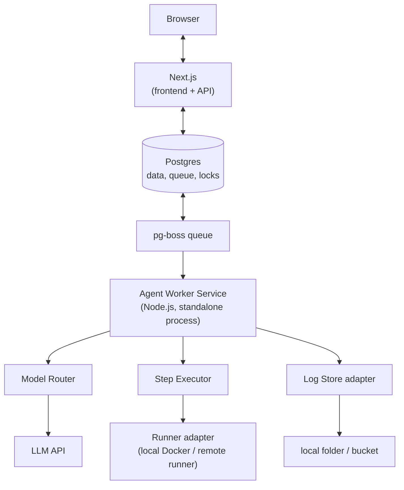
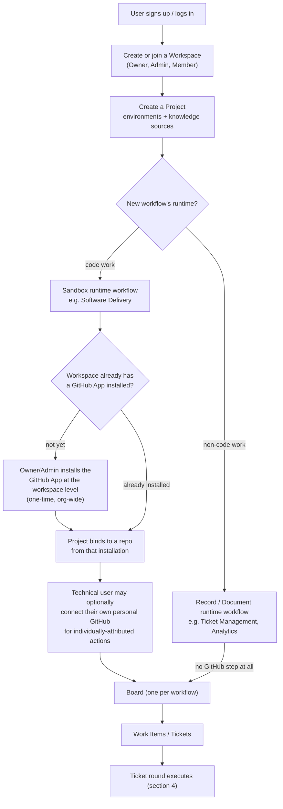

# Workcrew AI — Platform Overview

_Part of the Workcrew AI documentation set in `docs/`, per the documentation rule in [AGENTS.md](../AGENTS.md). This file is the product/architecture overview, derived from Technical Specification Revision 4 (replacing Cloudflare hosting with Postgres, local Docker and a pluggable log store, so the first build is small, cheap and runs on a laptop). For the detailed technology stack and adapter rulebook, see [tech-stack.md](./tech-stack.md)._

## 1. Purpose

This document describes a platform where AI agents do work that is tracked as kanban tickets. It keeps the generic design from Revision 4 (workflows, boards, work items, roles, runtimes), but simplifies the infrastructure so a small team can build it fast. It also lists every feature the platform needs; the staged rollout plan for building them lives in [roadmap.md](./roadmap.md).

**Core idea (unchanged):** the platform separates _what work is done_ (workflow definition) from _where it runs_ (runtime). Agents never act on their own; every action comes from a ticket. Agents do not call tools. They return a structured JSON step plan, and the platform validates and executes it.

## 2. Key Decisions

| Topic                  | Decision                                                                    | Why                                                                      |
| :---------------------- | :---------------------------------------------------------------------------- | :------------------------------------------------------------------------ |
| Database & ORM         | PostgreSQL + Prisma ORM                                                     | Schema definitions, migrations, row-level security, transactions, JSONB |
| Job queue              | pg-boss (Postgres-based queue)                                              | No new infrastructure; retries and dead-letter built in                 |
| Ticket state and locks | Postgres transactions and row locks (replaces Durable Objects)              | Same guarantees at this scale                                            |
| Live board updates     | Server-Sent Events, fed by Postgres LISTEN/NOTIFY                          | Simple, one-directional fit — see tech-stack.md §10                     |
| Logs and large files   | Storage adapter: local folder or object bucket, chosen by environment       | Same code in dev and production                                         |
| Command execution      | Runner adapter: local Docker or production runner, chosen by environment    | Same code in dev and production                                         |
| Agent protocol         | JSON step plan, no MCP                                                      | Lower token cost, safer, easier to audit (see section 5)                |
| Frontend + API         | Next.js (Route Handlers serve the API)                                      | One app, one deploy — no second backend framework (see tech-stack.md §2.1) |
| Agent service          | Node.js with TypeScript (Python optional later), standalone process        | Shares types and JSON schemas with the API (see section 6)              |

## 3. Environment Switching

A single setting, `APP_ENV`, decides where things run. The rest of the code never checks the environment; it only talks to two interfaces.

### 3.1 Runner adapter (command execution)

| Environment  | What happens                                                                                                                                                                            |
| :----------- | :-------------------------------------------------------------------------------------------------------------------------------------------------------------------------------------- |
| `local`      | The Sandbox runtime uses the developer's own local Docker. A container is started per stage run, the repo is mounted or cloned into it, and it is removed afterwards.                   |
| `production` | The same runtime contract is fulfilled by production resources: a remote isolated runner (for example a container service or Kubernetes job). The exact service is still to be decided. |

Both implement the runtime contract from Revision 4: `prepare(context)`, `execute(step)`, `snapshot()`, `cleanup()`.

**Safety rules that apply in both environments:** non-root user, dropped capabilities, CPU and memory limits, network policy, no Docker socket inside the container, and cleanup of orphaned containers. Local mode must not be treated as safe for untrusted code; it is for development only.

### 3.2 Log store adapter (logs, diffs, transcripts)

| Environment  | What happens                                                                                                  |
| :----------- | :------------------------------------------------------------------------------------------------------------ |
| `local`      | Files are written to a local folder, for example `./data/logs/{workspace_id}/{work_item_id}/{stage_run_id}/`. |
| `production` | The same files are written to a production bucket (any S3-compatible store).                                  |

The interface is deliberately tiny:

- `put(key, content)`: store a file
- `get(key)`: read a file
- `list(prefix)`: list files under a prefix
- `delete(key)`: remove a file (used by retention)

**Key layout (same in both environments):** `workspace_id/work_item_id/stage_run_id/round-N.json`, plus `commands/` and `diffs/` sub-paths. Postgres stores only the key and a short summary, never the full log.

### 3.3 Suggested environment variables

```
APP_ENV=local            # local | production
DATABASE_URL=postgres://...
LOG_LOCAL_DIR=./data/logs
LOG_BUCKET=...           # production only
RUNNER_MODE=docker-local # docker-local | remote
LLM_API_KEY=...          # per workspace in production
```

## 4. Architecture



**One ticket round**

1. A user creates a ticket on a board. The API saves it in Postgres.
2. The API enqueues a stage job with an idempotency key (`work_item_id + attempt_no + stage`).
3. The agent worker takes the job, builds the round input (rules, ticket, acceptance criteria, repo map, previous results) and the Model Router picks a model.
4. The LLM response is validated against the step JSON schema. An invalid plan gets one repair round, then the ticket escalates.
5. The Step Executor applies file edits and sends named commands to the runner.
6. Results are saved: summary in Postgres, full logs through the Log Store. Exit checks run, then the ticket moves to the next stage, retries, or waits for a human.
7. The board updates live.

**Consistency rule:** because the state change and the queue job are in the same Postgres database, the transition and the next job can be written in one transaction. A periodic reconciliation job still re-enqueues anything that went missing.

## 5. Agent Design: JSON Step Plan or MCP?

First, a clarification: the "no tools, no MCP" design is **not tied to Cloudflare**. It is a protocol choice and works the same on Postgres, Node.js and local Docker. Cloudflare was only the hosting in Revision 4.

### 5.1 Comparison

|                          | JSON step plan (platform executes)                                                                      | MCP (agent calls tools)                                                                   |
| :----------------------- | :------------------------------------------------------------------------------------------------------ | :---------------------------------------------------------------------------------------- |
| Token cost               | Lower: no tool schemas sent each call, many steps in one round                                          | Higher: tool definitions are sent every call, and each tool call is a round trip          |
| Number of LLM calls      | Fewer: a plan with several steps costs one call                                                         | More: one call per tool use, with the growing context resent each time                    |
| Safety                   | Strong: platform validates every step, allow-lists commands, blocks protected paths, gates side effects | Weaker by default: the agent decides at runtime, so safety must be added around each tool |
| Auditability             | Every plan and result is stored per round                                                               | Possible, but you must capture it yourself                                                |
| Adaptiveness             | Lower inside one round: the agent cannot see step 1's result before writing step 2                      | Higher: the agent reacts after every tool result                                          |
| Setup effort             | You build a schema, validator and executor                                                              | You can reuse existing MCP servers quickly                                                |
| Third-party integrations | You write each connector                                                                                | Large ecosystem of ready servers                                                          |
| Model reliability        | Needs strict JSON; one repair attempt                                                                   | Tool calling is natively supported by most models                                         |

### 5.2 Recommendation

Use the **JSON step plan**. It is cheaper, safer and easier to audit, and our work (edit code, run named commands, update tickets) fits a fixed set of step types. The adaptiveness gap is handled by running several short rounds, where results of one round feed the next.

MCP is the better choice when the agent needs open-ended exploration, many unknown third-party tools, or tools that change often. We do not need that here.

### 5.3 Future hybrid

If we later want MCP's ecosystem, keep the same safety model: **the platform acts as the MCP client, not the agent**. A new step type such as `call_connector` names an approved connector and operation. The agent only emits that step in JSON; the platform checks permissions, calls the MCP server, scrubs the result and returns it. This keeps cost and safety benefits while gaining integrations.

### 5.4 Step types

| Step type                                               | Runtime | Purpose                                             |
| :------------------------------------------------------ | :------ | :-------------------------------------------------- |
| `search_code`                                           | Sandbox | grep in the worktree                                |
| `read_file`                                             | Sandbox | read lines from a file                              |
| `edit_file`                                             | Sandbox | anchor-based change; anchor must match exactly once |
| `create_file`                                           | Sandbox | write a new file                                    |
| `run_command`                                           | Sandbox | run a named role command (setup, build, test, lint) |
| `update_ticket`, `add_comment`, `assign`, `draft_reply` | Record  | change platform records (later phase)               |
| `final`                                                 | Any     | end the attempt with status and summary             |

Every round returns one JSON object with `round`, `summary`, `steps`, and `status` (`continue`, `done` or `blocked`).

**Error-reduction rules**

- Strict JSON Schema validation, one repair attempt, then a visible failure.
- Steps run in order; a failed step stops the round and earlier edits stay.
- Each step has an id, so a retried round never repeats applied steps.
- Only commands on the role's list can run.
- Protected paths are rejected.
- Side-effect steps (push code, send email, close ticket) wait for human approval.
- Results are truncated and scrubbed of secrets before being returned.
- Repository, ticket and email content is treated as data, never as instructions.

## 6. Technology Stack

The detailed technology stack, service boundaries, Prisma ORM database models, and environment configurations are maintained in [tech-stack.md](./tech-stack.md).

**Summary of Core Stack:**

- **Frontend + API:** Next.js (React, TypeScript, Tailwind, Monaco, xterm.js; Route Handlers serve Auth, Users & RBAC, Projects, Boards, and the SSE endpoint — one app, no separate backend framework)
- **Database & ORM:** PostgreSQL 16 + Prisma ORM (Schema, migrations, row-level security)
- **Job Queue:** `pg-boss` (PostgreSQL-based queue with `SKIP LOCKED`)
- **Agent Worker:** Node.js with TypeScript, standalone process, running the JSON Step Protocol and Model Router
- **Sandbox Execution:** Switchable via `APP_ENV`: Local Docker (`dockerode`) or remote isolated runner

## 7. Domain Model (kept from Revision 4)

```
Workspace
  GitHub App installation (org-level, optional — only needed for Sandbox-runtime workflows)
  Project
    Shared: environments, knowledge sources
    Workflow: Software Delivery -> Board      (Sandbox runtime — needs GitHub)
    Workflow: Ticket Management -> Board      (Record runtime — no GitHub)
    Workflow: Analytics / Reporting -> Board  (Document runtime — no GitHub)
```

- A project has 1 to N workflows; each workflow has one board.
- A work item (ticket) belongs to one workflow at a time. Links to other workflows are references.
- Workflow definitions are versioned; a run pins the version it started with.
- Parent work items (a Requirement) can have child work items (atomic tickets made by the Planner).
- **A workflow's runtime decides whether GitHub is involved, not the project.** A project can hold both a code workflow and a non-code workflow side by side — see 7.1.

### 7.1 Two Setup Flows: GitHub (Tech) vs. No-GitHub (Non-Tech)

This is the path a user takes before any ticket round (section 4) can happen. It branches the moment a workflow is created, based on that workflow's runtime (section 9.5):

- **Sandbox runtime** (e.g. Software Delivery) — code work. Requires a GitHub connection, because the Step Executor commits edits and opens Draft PRs.
- **Record or Document runtime** (e.g. Ticket Management, Analytics/Reporting) — no code involved. Never touches a GitHub connection at all, even if one exists elsewhere in the workspace.



**GitHub / tech flow** (Sandbox-runtime workflows, typically technical users):

1. User signs up, creates or joins a Workspace (role: Owner, Admin, or Member).
2. User creates a Project — environment variables and knowledge sources are set here, shared by every workflow in the project.
3. User adds a Sandbox-runtime workflow (e.g. Software Delivery). The platform checks whether the workspace already has a GitHub App installed.
4. If not, an **Owner or Admin** installs the GitHub App once, at the workspace level — this is the org-wide connection, not tied to any one person.
5. The project binds to a specific repo made available by that installation.
6. A technical user may **optionally** also connect their own personal GitHub account, purely so manual actions (a direct push, a review) can be attributed to them individually. This is never required to use the platform.
7. Tickets on this workflow's board run the full ticket-round flow (section 4): the Runner Adapter spins up a sandbox, the Step Executor edits files and runs commands against the bound repo, and Draft PRs are opened under the workspace's GitHub App identity unless a personal connection says otherwise.

**No-GitHub / non-tech flow** (Record or Document-runtime workflows, typically non-technical users):

1. User signs up, joins a Workspace that may or may not have GitHub connected — it doesn't matter for this flow.
2. User creates (or is already inside) a Project, and adds a Record or Document-runtime workflow (e.g. Ticket Management, Analytics/Reporting).
3. No GitHub step is ever shown or required — this workflow has no Runner Adapter and never emits `edit_file`/`run_command` sandbox steps.
4. Tickets on this board still run the same round/step-plan mechanics (section 4, section 5.4), but only against platform records, connectors (email, forms), or documents.
5. Any user — technical or not — can fully use this workflow without ever seeing a GitHub connection prompt.

**Why this split matters:** it means GitHub setup is a one-time, org-level cost that only technical workflows ever require, so a non-technical teammate (support, analytics, PM) can be fully productive in the same workspace without any GitHub access of their own, and without the platform ever asking them for it.

### 7.2 Core tables

| Table                                                             | Purpose                                                |
| :---------------------------------------------------------------- | :----------------------------------------------------- |
| `workspaces`, `users`, `memberships`                              | Tenant and access                                      |
| `projects`                                                        | Repo binding, settings                                 |
| `environments`                                                    | Encrypted variables per project                        |
| `workflow_definitions`, `workflow_stages`, `workflow_transitions` | Blueprint (one seeded workflow at first)               |
| `boards`                                                          | One per workflow                                       |
| `work_items`, `work_item_events`                                  | Tickets and immutable timeline                         |
| `workflow_runs`, `stage_runs`                                     | Execution records                                      |
| `roles`, `role_commands`, `role_rules`                            | AI role definitions                                    |
| `step_plans`, `step_results`                                      | Per-round plans and outcomes (log keys, not full logs) |
| `routing_decisions`                                               | Which model was chosen and why                         |
| `usage_events`                                                    | Tokens and cost per call                               |
| `audit_log`                                                       | Append-only record of sensitive actions                |

Every tenant table carries `workspace_id`, `created_at`, `updated_at`. Use Postgres row-level security as a second layer on top of scoped queries.

## 8. Governance and Cost Control

- **Budget guard:** a pre-call check against per-call, per-stage, per-workflow, per-project and per-workspace limits. At the cap the ticket pauses as `budget_exceeded`.
- **Model Router:** each role is `fixed` (one model) or `auto`. Models are grouped into Economy, Standard and Premium tiers in configuration. The router escalates one tier after a failure and logs every decision.
- **Token reduction before bigger models:** compact repo map, relevant excerpts only, prompt caching for stable context, compact JSON output, and a per-call output cap.
- **Secrets:** envelope encryption; secrets never enter prompts and are scrubbed from logs.
- **Gates:** merging code is always human. External side effects are gated by default.
- **Observability:** structured logs carrying `workspace_id`, `workflow_id`, `work_item_id`, `job_id`; metrics for queue depth, failures and spend.

### 8.1 Default model tier by task and priority

| Task                       | Low      | Normal   | High or Urgent |
| :------------------------- | :------- | :------- | :------------- |
| Classification and triage  | Economy  | Economy  | Economy        |
| Planning and decomposition | Standard | Standard | Premium        |
| Implementation             | Economy  | Standard | Standard       |
| Retry after failure        | Standard | Standard | Premium        |
| Verification and review    | Economy  | Standard | Standard       |
| Reply drafting             | Economy  | Economy  | Standard       |

## 9. Full Feature List

Everything the platform needs, grouped by area. The staged build-out plan for these is in [roadmap.md](./roadmap.md).

### 9.1 Projects and workspaces

- Workspaces with users and roles (Owner, Admin, Member)
- GitHub App installed once at the workspace level (Owner/Admin only) — only needed once a project has a Sandbox-runtime workflow; see section 7.1
- Projects bind to a repo from the workspace's GitHub App installation, plus branch templates
- Optional per-user personal GitHub connection, for actions attributed to that individual rather than the workspace's shared identity
- Encrypted environment variables per project, multiple environments later
- Knowledge sources (documents, wiki, help center)
- Shared connectors (email, forms, issue trackers)

### 9.2 Workflows

- Seeded Software Delivery template (Sandbox runtime — needs the workspace's GitHub connection)
- Ticket Management template (Record runtime — no GitHub needed)
- Analytics / Reporting template (Document runtime — no GitHub needed)
- Workflow and stage builder with custom stages
- Per-stage role, runtime, gate, exit checks and limits
- Workflow versioning with pinned runs
- Template marketplace

### 9.3 Boards and tickets

- Boards page grouped by project with counts, active runs and monthly cost
- Kanban view with live updates
- Ticket detail: description, acceptance criteria, timeline, rounds, step plans, diffs, cost
- Parent cards with expandable child tickets
- Allowed-transition drag and drop; approval for gated stages
- Priorities (Low, Normal, High, Urgent)
- Saved views, filters, swimlanes, labels, assignees
- Ticket creation by user, email or form
- Cross-workflow links (manual first, automatic later)

### 9.4 Agents and roles

- Role templates: Planner, Developer, Verifier, Reviewer, Triage Agent, Support Agent
- Custom roles with prompt, attached rules, allowed step types, limits
- Platform rules that cannot be removed; user rules for team conventions
- Role commands (setup, build, run, health, test, lint, custom)
- Prompt and rule versioning
- Model pinning per role or ticket

### 9.5 Execution

- Sandbox runtime: local Docker and production runner
- Record runtime: tickets and connectors, no containers
- Document runtime: versioned documents and source search
- Git integration: branch, commit, Draft PR, merge webhook
- Retry, repair round and loop detection
- Anchor-based edits committed through the GitHub API without a persistent checkout
- Optional platform-side MCP connectors (section 5.3)

### 9.6 Governance and operations

- Budgets at every level; usage and cost dashboards
- Audit log and exports
- Log retention and cleanup jobs
- Tenant isolation tests
- Reconciliation sweep
- Notifications (email, Slack)
- Auto-send for approved reply stages
- Single sign-on and fine-grained permissions

## 10. Technical Documents to Maintain

Keep these files in the `/docs` folder of the repository so the overview stays short and details live in focused documents. **Current status:** the documentation set is currently split into three files — `docs/overview.md` (this file), `docs/tech-stack.md`, and `docs/roadmap.md` — per the documentation rule in [AGENTS.md](../AGENTS.md). Split a row below out into its own file only once it would otherwise make one of those hard to navigate; don't split preemptively.

| File                            | Contents                                                            |
| :------------------------------ | :------------------------------------------------------------------ |
| `docs/overview.md`              | This document                                                       |
| `docs/01-architecture.md`       | Services, data flow, sequence of one ticket round, failure handling |
| `docs/02-data-model.md`         | Tables, columns, indexes, row-level security policies, migrations   |
| `docs/03-api-nextjs.md`         | Next.js Route Handlers, endpoints, auth, validation, SSE events     |
| `docs/04-frontend-nextjs.md`    | Pages, components, state handling, board and ticket detail design   |
| `docs/05-agent-service.md`      | Round loop, role prompts, rules, Model Router, budget guard         |
| `docs/06-step-protocol.md`      | JSON schema for step plans, step types, error messages, examples    |
| `docs/07-runtimes.md`           | Runtime contract, Docker local, remote runner, hardening rules      |
| `docs/08-log-store.md`          | Adapter interface, key layout, retention, local versus bucket setup |
| `docs/09-environments.md`       | `APP_ENV` behavior, variables, local setup with docker-compose      |
| `docs/10-security.md`           | Secrets, tenant isolation, untrusted input, audit log, threat notes |
| `docs/11-github-integration.md` | GitHub App, branch rules, Draft PR, merge webhook                   |
| `docs/13-testing.md`            | Unit, integration and isolation tests, agent evaluation set         |
| `docs/tech-stack.md`            | Technology stack and adapter rulebook                               |
| `docs/roadmap.md`               | Staged build-out plan, status, and decisions log                    |
| `docs/vercel-sandbox.md`        | Vercel Sandbox reference and fit check for the production Runner Adapter (undecided — see section 11) |

## 11. Open Decisions

| Decision          | Options                                                        | Recommendation                                                              |
| :---------------- | :------------------------------------------------------------- | :---------------------------------------------------------------------------- |
| Production runner | Container service, Kubernetes jobs, a managed sandbox provider | Decide early, before scaling past local-only usage; keep the runner adapter swappable |
| Production bucket | Any S3-compatible store                                        | Pick the provider already used by the team                                  |
| Queue             | pg-boss or a separate broker (Redis)                           | pg-boss until load requires more                                            |
| Live updates      | SSE or WebSocket                                               | SSE first; WebSocket if two-way features are needed                         |
| Agent language    | Node.js or Python                                              | Node.js now, Python only for data-heavy work                                |
| Boards            | One workflow per board or one board across workflows           | One workflow per board                                                      |

## 12. Main Risks

- **Local Docker is not a security boundary for untrusted code.** Treat local mode as development-only and harden the production runner.
- **Over-building early.** The first build ships one workflow on the generic model; no visual workflow designer yet.
- **Cost surprises.** Budgets and step limits apply to every workflow, including those without containers.
- **Loss of the Cloudflare isolation features.** Row-level security in Postgres and isolation tests must replace what Durable Objects and D1 scoping gave us.
- **Prompt injection.** Repository, ticket and email content is always data; steps are validated by the platform regardless of what the model returns.
