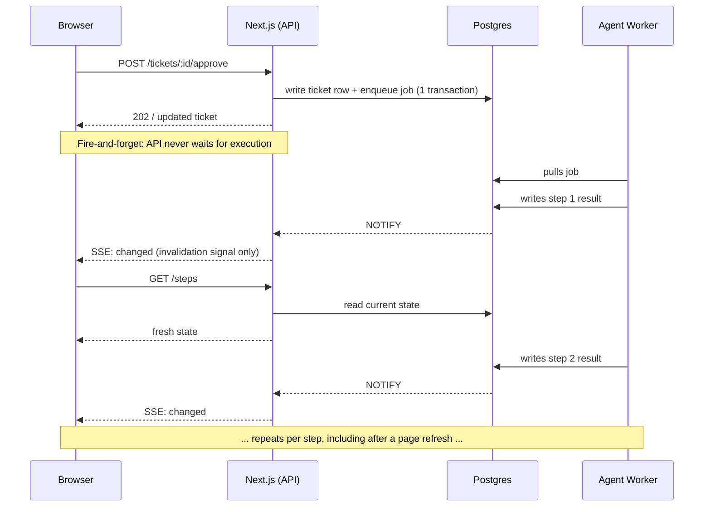

# Workcrew AI — Technology Stack & Adapter Rulebook

_Part of the Workcrew AI documentation set in `docs/`, per the documentation rule in [AGENTS.md](../AGENTS.md). This file is the single source of truth for: (1) what technology each part of the platform uses, (2) the adapter pattern that lets `local` and `production` run on completely different infrastructure behind the same code, and (3) the exact rules for what switches and what stays fixed between environments. Sections below are numbered independently from [overview.md](./overview.md)._

## 1. Guiding Principle

**One switch, two worlds.** A single environment variable, `APP_ENV` (`local` | `production`), decides everything. No business logic, no service, and no agent code ever branches on `APP_ENV` directly — they only ever call an **adapter interface**. The adapter implementation is swapped at startup via dependency injection.

- `local` → free, self-hosted, zero external billing. Built for a laptop.
- `production` → managed cloud services, paid where needed, built for reliability and multi-tenant safety.

If a component cannot be made to work identically in both worlds behind one interface, it is not a shared component — split it into its own adapter.

## 2. Core Stack (same in every environment)

These are fixed regardless of `APP_ENV`. They are all free/open-source, so there is no adapter needed — only where they are _hosted_ changes (see section 4).

| Layer           | Technology                                                                          | Notes                                                                                          |
| :-------------- | :---------------------------------------------------------------------------------- | :--------------------------------------------------------------------------------------------- |
| Frontend + API  | Next.js (React, TypeScript, Tailwind, Monaco, xterm.js; Route Handlers for the API) | One app, one deploy — replaces a separate NestJS service (see 2.1)                             |
| Database        | PostgreSQL 16                                                                       | Local container in dev, managed instance in prod                                               |
| ORM             | Prisma                                                                              | Schema, migrations (`prisma migrate`), row-level security                                      |
| Job Queue       | pg-boss (Postgres-based, `SKIP LOCKED`)                                             | No separate broker; same Postgres instance                                                     |
| Agent Worker    | Node.js + TypeScript, **standalone process**                                        | Runs the JSON Step Protocol and Model Router — never folded into the Next.js process (see 2.1) |
| Live Updates    | Server-Sent Events (SSE) over Postgres `LISTEN/NOTIFY`                              | Invalidation signals only — full flow in section 10                                            |
| Git Integration | GitHub (PAT + webhook for MVP1; GitHub App later)                                   | See section 6                                                                                  |

### 2.1 Why Next.js instead of NestJS

The API surface here — auth, RBAC, tickets, boards, plus the SSE endpoint — is mostly CRUD. Next.js Route Handlers cover that fully, so there's no need to run a second backend framework: one app, one deploy, one less service to operate and keep in sync with the frontend.

**This does not move the Agent Worker into Next.js.** It stays a separate, always-on Node.js process no matter which framework serves the API, because:

- It needs direct Docker socket access (`dockerode`) for the sandbox — a public-facing web process shouldn't hold that access, and a serverless/Fargate deployment of the web tier can't hold it at all.
- Its rounds run for minutes, not milliseconds — it doesn't fit a request/response lifecycle.
- It scales on queue depth, not HTTP traffic, so it needs to scale independently of the web tier.

## 3. The Three Adapters

Everything environment-sensitive is isolated behind exactly three adapter interfaces. Each has a `local` implementation and a `production` implementation, selected by `APP_ENV` at process startup.

### 3.1 LLM Adapter (model inference)

|                       | `local`                                                                                       | `production`                                                                  |
| :-------------------- | :-------------------------------------------------------------------------------------------- | :---------------------------------------------------------------------------- |
| **Implementation**    | Ollama, running in its own Docker container                                                   | Hosted/cloud model API (Anthropic, OpenAI, or any OpenAI-compatible endpoint) |
| **Models**            | Open-weight models pulled into Ollama: `qwen2.5-coder`, `deepseek-coder-v2`, `llama3.1`, etc. | Claude / GPT-class models, selected per Model Router tier                     |
| **Cost**              | $0 — local compute only                                                                       | Pay-per-token, governed by the budget guard (overview.md section 8)           |
| **Auth**              | None — local HTTP endpoint                                                                    | API key, stored via the Secrets rule (section 7)                              |
| **Structured output** | Ollama JSON mode / grammar-constrained decoding to force schema-valid step plans              | Native structured-output / tool-use JSON mode                                 |

```ts
interface LlmAdapter {
	complete(input: ModelRequest): Promise<ModelResponse>;
	supportsStructuredOutput(): boolean;
}
```

- `local`: `OllamaLlmAdapter` → calls `LLM_BASE_URL` (default `http://localhost:11434`), no key required.
- `production`: `CloudLlmAdapter` → calls the provider named by `LLM_PROVIDER`, authenticated with `LLM_API_KEY` (per-workspace, envelope-encrypted — see section 7).
- **Escalation rule:** the Model Router's tiers (overview.md section 8.1) map onto this adapter as **Local → Cloud**, not just Economy → Standard → Premium. In `local` dev, every tier resolves to the same local Ollama model unless a cloud key is explicitly configured for testing. In `production`, tiers map to real Economy/Standard/Premium cloud models. A local-only deployment never needs a paid key at all.

### 3.2 Runner Adapter (sandboxed code execution)

|                    | `local`                                                                | `production`                                                                                                                         |
| :----------------- | :----------------------------------------------------------------------- | :------------------------------------------------------------------------------------------------------------------------------------- |
| **Implementation** | Developer's own Docker Engine, driven via `dockerode`                  | Remote isolated runner (container service or Kubernetes job — see Open Decisions)                                                   |
| **Lifecycle**      | Container started per stage run, repo mounted/cloned in, removed after | Same contract, fulfilled by a managed/remote execution backend                                                                       |
| **Safety**         | Dev-only — **not a security boundary for untrusted code**              | Non-root user, dropped capabilities, CPU/memory limits, network policy, no Docker socket access, orphan cleanup — enforced for real |

```ts
interface RunnerAdapter {
	prepare(context: RunContext): Promise<void>;
	execute(step: Step): Promise<StepResult>;
	snapshot(): Promise<Snapshot>;
	cleanup(): Promise<void>;
}
```

- `local`: `DockerRunnerAdapter` (`RUNNER_MODE=docker-local`).
- `production`: `RemoteRunnerAdapter` (`RUNNER_MODE=remote`) — concrete provider is an open decision (overview.md section 12); keep this adapter swappable so picking one later doesn't touch calling code.

### 3.3 Log Store Adapter (logs, diffs, transcripts)

|                    | `local`                                                     | `production`                             |
| :----------------- | :----------------------------------------------------------- | :----------------------------------------- |
| **Implementation** | Local filesystem folder                                     | S3-compatible object bucket              |
| **Path**           | `./data/logs/{workspace_id}/{work_item_id}/{stage_run_id}/` | Same key layout, written to `LOG_BUCKET` |

```ts
interface LogStoreAdapter {
	put(key: string, content: Buffer | string): Promise<void>;
	get(key: string): Promise<Buffer>;
	list(prefix: string): Promise<string[]>;
	delete(key: string): Promise<void>;
}
```

- `local`: `LocalFolderLogStore`.
- `production`: `S3BucketLogStore`.
- Postgres **never** stores full logs in either environment — only the key and a short summary (overview.md section 3.2).

## 4. Hosting Map (what moves to the cloud in production)

The core stack (section 2) doesn't change technology, only _where it runs_:

| Component                | `local` hosting                           | `production` hosting                                                                                                                          |
| :----------------------- | :------------------------------------------ | :------------------------------------------------------------------------------------------------------------------------------------------- |
| PostgreSQL               | Docker container on laptop                | Managed Postgres (e.g. Neon, Supabase, RDS — pick the cheapest that supports row-level security)                                              |
| pg-boss queue            | Same local Postgres                       | Same managed Postgres — no separate infra                                                                                                     |
| Next.js (frontend + API) | `next dev` / local Docker, single process | Containerized on ECS (EC2 launch type) or EC2, behind an ALB                                                                                  |
| Agent Worker             | Local Node process                        | Separate ECS task (**EC2 launch type**, not Fargate) or standalone EC2 instance — needs Docker socket access, kept off the public-facing tier |
| Ollama (LLM)             | Local Docker container                    | **Not used** — replaced entirely by the Cloud LLM adapter                                                                                     |
| Docker sandbox           | Local Docker Engine                       | **Not used** — replaced entirely by the Remote Runner adapter                                                                                 |
| Logs                     | Local folder                              | S3-compatible bucket                                                                                                                          |

**Rule:** nothing in this table requires a code change to move rows — only an `.env` change and the adapter factory picking the other branch.

## 5. Environment Variables (the switchboard)

```
APP_ENV=local                  # local | production — the only hard switch

# Database (always Postgres, local or managed)
DATABASE_URL=postgres://...

# LLM adapter
LLM_PROVIDER=ollama            # ollama | anthropic | openai | <other openai-compatible>
LLM_BASE_URL=http://localhost:11434   # required for ollama; ignored for cloud providers
LLM_API_KEY=                   # empty/unused for ollama; required for cloud providers, per-workspace in production

# Runner adapter
RUNNER_MODE=docker-local       # docker-local | remote
RUNNER_REMOTE_ENDPOINT=        # production only, once a provider is chosen (overview.md section 12, Open Decisions)

# Log store adapter
LOG_LOCAL_DIR=./data/logs      # used when APP_ENV=local
LOG_BUCKET=                    # used when APP_ENV=production (any S3-compatible store)
```

**Rule:** a fresh clone with only `APP_ENV=local` and a `DATABASE_URL` set must be able to run the entire loop (ticket → plan → sandbox → Draft PR) with **zero paid services**. Anything that breaks that is a bug in the adapter, not an acceptable exception.

## 6. Git Integration Rule

- **MVP1 (local):** a GitHub App's **`oauth-user` (OAuth) token**, obtained via `@octokit/auth-app`'s `createAppAuth({ appId, privateKey, clientId, clientSecret })` + `auth({ type: 'oauth-user', code, state })`. The user clicks "Connect GitHub," authorizes once, and the resulting token is stored (encrypted) and used directly — no manual PAT to generate or paste, no `installationId` lookup. See `docs/vercel-sandbox.md` for the full flow and code.
- **Later (production, multi-tenant):** upgrade to the GitHub App's **`installation` token** flow (`installationId`-based), so each workspace gets a shared, org-wide bot identity instead of every action being attributed to one individual — per `overview.md` §7.1. Both strategies come from the same `createAppAuth` call and the same registered GitHub App, so this is a drop-in swap behind the same "create branch / open Draft PR / read merge webhook" interface — not a rewrite, and not a second app to register.

## 7. Secrets Rule (applies in both environments)

- Secrets (cloud `LLM_API_KEY`, `RUNNER_REMOTE_ENDPOINT` credentials, bucket credentials) are envelope-encrypted at rest.
- Secrets never enter LLM prompts and are scrubbed from logs before they reach the Log Store.
- In `local`, most of these are simply unset — there is nothing to encrypt when the LLM and runner are both local and keyless.

## 8. Budget Guard Rule

- In `local`: the budget guard is effectively a no-op — local Ollama inference and local Docker execution cost no metered dollars. It still tracks token/compute usage for visibility, but does not need to enforce a hard spend cap.
- In `production`: the full budget guard from overview.md section 8 applies — per-call, per-stage, per-workflow, per-project, per-workspace caps, enforced before every cloud LLM call and every remote runner invocation.
- **Rule of thumb:** if a tier in the Model Router resolves to a cloud model (even while `APP_ENV=local`, for manual testing), the budget guard switches on for that call regardless of environment.

## 9. Adapter Selection at Startup

All three adapters are chosen once, at process boot, via a single factory read from `APP_ENV` (and `LLM_PROVIDER` / `RUNNER_MODE` for finer-grained overrides within `production`). No downstream code imports a concrete adapter class directly — only the interface.

```ts
const llmAdapter: LlmAdapter =
	env.LLM_PROVIDER === "ollama"
		? new OllamaLlmAdapter()
		: new CloudLlmAdapter();

const runnerAdapter: RunnerAdapter =
	env.RUNNER_MODE === "docker-local"
		? new DockerRunnerAdapter()
		: new RemoteRunnerAdapter();

const logStoreAdapter: LogStoreAdapter =
	env.APP_ENV === "local"
		? new LocalFolderLogStore()
		: new S3BucketLogStore();
```

This keeps the rule simple: **write the interface once, implement it twice, switch with one env var.**

## 10. Execution Flow: Fire-and-Forget + Event-Sourced Status

Every user-triggered action (create ticket, approve a gated stage, retry a failed round) follows the same pattern: the API never waits for the agent to actually finish the work before responding to the browser.

### 10.1 The flow

1. **Request lands** — e.g. `POST /tickets/:id/approve`. The Next.js Route Handler validates it and, in one Postgres transaction, (a) writes whatever state is immediately knowable (e.g. ticket → `in_progress`) and (b) enqueues a pg-boss job with an idempotency key (`work_item_id + attempt_no + stage`).
2. **API responds immediately** — the updated ticket row goes back to the browser before any LLM call or Docker container has started. This is the fire-and-forget part: the HTTP request's lifecycle is fully decoupled from the agent's execution lifecycle.
3. **Agent Worker executes asynchronously** — the separate worker process pulls the job off the queue and runs the round loop. For every meaningful transition (step started, step done/failed, round finished, stage changed) it writes a row to Postgres and nowhere else. Postgres is the only system of record — nothing is held only in the worker's memory or in an HTTP response.
4. **Each write fires a Postgres `NOTIFY`** — the worker never talks to SSE clients directly; it only ever talks to Postgres.
5. **The API relays it as an SSE invalidation signal** — the Next.js process `LISTEN`s on the Postgres channel and forwards a small payload (`{ workItemId, stageRunId, stepId }`) to subscribed clients. It is a "go look" signal, not a copy of the data.
6. **The client refetches — it never trusts the push payload** — on receiving the signal, the browser re-runs its normal `GET /tickets/:id` (or a narrower `/steps` endpoint) and renders whatever Postgres currently says. That's identical to what happens on first load or after a page refresh — there is no separate code path for "live" vs. "just reconnected."

### 10.2 Sequence



### 10.3 Why this combination matters

- **Fire-and-forget keeps the API fast and simple** — it never blocks on an LLM call or a Docker container, both of which can take seconds to minutes.
- **Postgres-as-truth makes the SSE channel disposable** — losing the connection (refresh, dropped network, server restart) never loses data, because the channel never carried the data, only the "go look" signal.
- **Idempotency keys prevent duplicate work** — if the fire-and-forget request is retried (e.g. a flaky client retry), the same `work_item_id + attempt_no + stage` key means pg-boss and the worker treat it as the same job, not a new one.
- **This is the same consistency rule already in the overview (overview.md section 4):** because the state write and the job enqueue happen in one transaction, there's never a job without matching ticket state, or ticket state without a corresponding job.
- **Granularity is a schema choice, not an architecture change** — writing per-step (not just per-round) to `step_results`, each with a `status`/`started_at`/`completed_at`, is what gives the live UI step-level progress instead of only round-level progress, for free, through this same flow.
